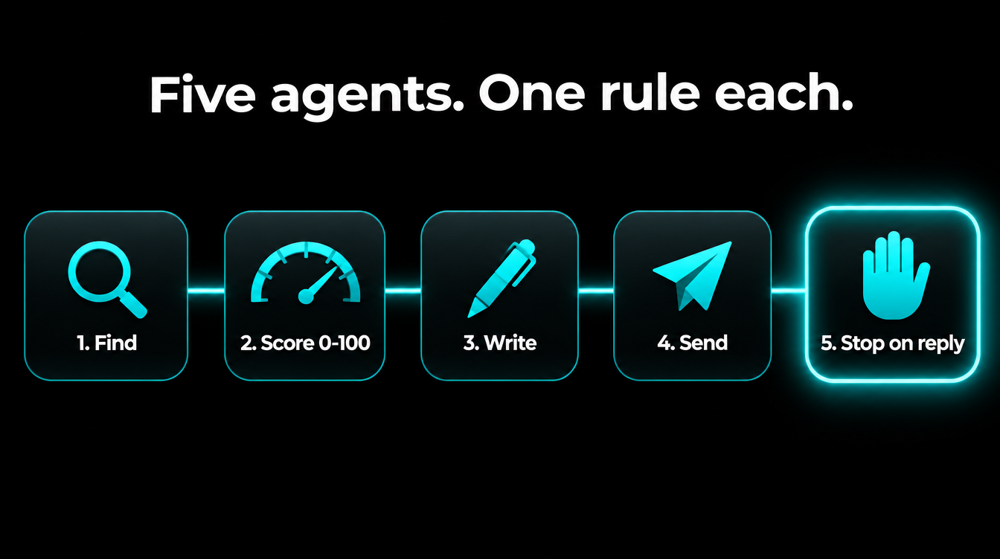

<div align="center">

<a href="https://www.phantera-tn.com/en"></a>

<br/>

<a href="https://www.phantera-tn.com/en"></a>
<a href="https://www.youtube.com/watch?v=F6fZduE7Alg"></a>
<a href="https://www.linkedin.com/company/phantera-tn/"></a>
<a href="https://medium.com/@phantera"></a>

<br/><br/>

### B2B prospecting that knows when to stay quiet.

</div>

<br/>

> You have already answered "no thanks" to a cold email.
> Three days later, it came back anyway.
>
> Nobody was rude. The software simply never read your reply.
>
> **Phantera is built around the opposite rule.**

<br/>

## How it works

<div align="center">

</div>

<br/>

| | Agent | What it does |
|:-:|---|---|
| 1 | **Find** | Finds the decision makers that match your ideal customer |
| 2 | **Score** | Scores every lead from 0 to 100, with a verified email |
| 3 | **Write** | Writes and rewrites each message until it is good, and you approve it |
| 4 | **Send** | Sends one sequence by email, LinkedIn, WhatsApp and SMS, from your own accounts |
| 5 | **Stop** | Stops the sequence as soon as the prospect replies |

The fifth agent is the reason the other four exist.

<br/>

## The rule nobody demos

Every outreach demo shows a beautiful first email. Nobody demos day 4, when the prospect answers.

```text
prospect replies  ──▶  sequence stops  ──▶  reply sorted  ──▶  a human answers
                                             positive · meeting · neutral · negative
```

A yes, a no, or a "not now": the moment someone answers, nobody gets the follow-up they should never have received.

<br/>

## See it in 40 seconds

<div align="center">
<a href="https://www.youtube.com/watch?v=F6fZduE7Alg"></a>
</div>

<br/>

## Gifts to our community

<a href="https://github.com/phantera-ai/rightsize"></a>

**[rightsize](https://github.com/phantera-ai/rightsize)** · The Claude Code plugin we use to build Phantera. Same quality, up to 98% cheaper on measured tasks. Free, MIT, one-line install. If it saves you a dollar, pay us in stars.

More to come. Watch this organization to get the next one the day it ships.

<br/>

## Compare before you choose

We read the help centers so you don't have to.

- [Phantera vs lemlist](https://www.phantera-tn.com/en/alternative/lemlist)
- [Phantera vs La Growth Machine](https://www.phantera-tn.com/en/alternative/la-growth-machine)
- [Phantera vs Instantly](https://www.phantera-tn.com/en/alternative/instantly)
- [Phantera vs Waalaxy](https://www.phantera-tn.com/en/alternative/waalaxy)

<br/>

## Read

- [Forward a cold email to a colleague and the follow-ups keep coming. I read 4 help centers to find out why.](https://dev.to/ayoub_hammoudi/forward-a-cold-email-to-a-colleague-and-the-follow-ups-keep-coming-i-read-4-help-centers-to-find-1kfh)
- [6 questions to ask any outreach tool before you trust it with your prospects](https://medium.com/@phantera/6-questions-to-ask-any-outreach-tool-before-you-trust-it-with-your-prospects-fa036bf57596)
- [The email came back anyway. The Phantera notebook, in 11 pages.](https://medium.com/@phantera)

<br/>

## Who it's for

Consulting firms, IT services companies and B2B agencies of 2 to 20 people who sell to other businesses and refuse to spam their own market.

<br/>

## Built by

Three co-founders, made in France.

**Ayoub Hammoudi** · **Zakaria Khchiche** · **Mehdi Terbeche**

<br/>

<div align="center">

**Free plan: 100 leads a month, no credit card.**

<a href="https://www.phantera-tn.com/en"></a>

<sub>Phantera is sold by E-KIGAI.</sub>

</div>
